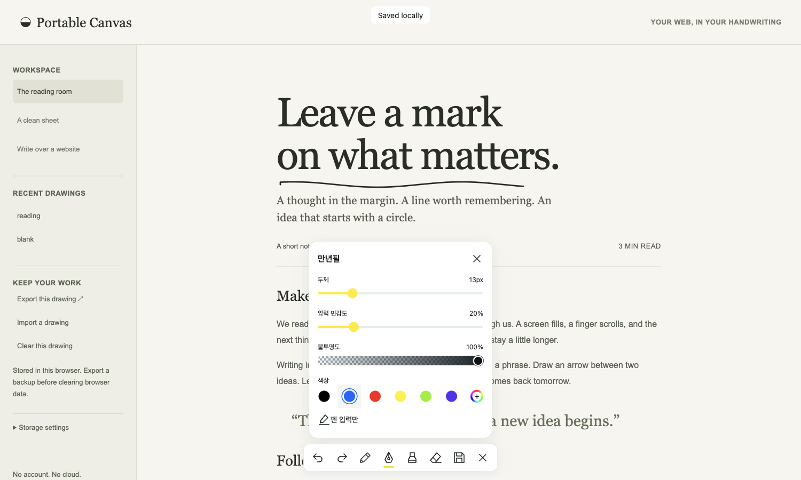
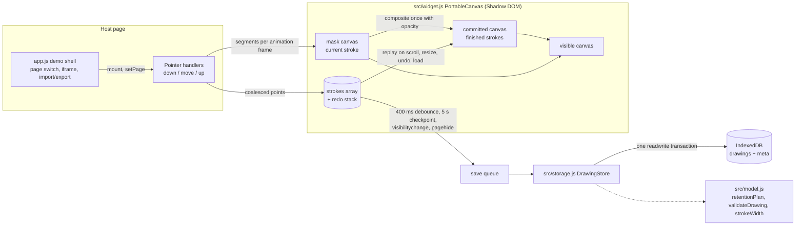

# Portable Canvas

A dependency-free drawing layer you can drop onto a web page you control: pen, fountain pen, highlighter and eraser, autosaved per page in the browser's IndexedDB.

Live: https://portable-canvas.vercel.app (landing) · https://portable-canvas.vercel.app/demo.html (drawing demo)



## Problem it solves

Underlining and leaving handwritten notes on a page you are reading usually means leaving the page for a separate note app. Portable Canvas puts a pen button on the page itself. Tap it to draw with Apple Pencil, an Android stylus, a finger or a mouse, and the marks for that page come back the next time it opens. Nothing leaves the browser: there is no account, server or runtime dependency.

## Architecture



Deeper notes: [docs/architecture.md](docs/architecture.md). Decision records: [docs/adr/](docs/adr/).

## Key technical decisions

- **Three viewport-sized canvases instead of a page-sized bitmap** (`src/widget.js` `resize`, `composite`, `present`). The visible canvas shows a committed bitmap plus a mask holding only the in-progress stroke. The device pixel ratio is capped at 2. Strokes are stored in document coordinates, so ink follows host scrolling while memory stays bounded by the viewport. See [ADR 0001](docs/adr/0001-viewport-canvases-with-stroke-mask.md).
- **Opacity is applied once per stroke** (`composite` in `src/widget.js`). Each stroke is drawn opaque into the mask, then composited with its opacity. A 35% highlighter therefore does not darken where segments join or the stroke crosses itself. The eraser composites with `destination-out`.
- **Atomic save with optimistic versioning and LRU retention** (`src/storage.js` `save`, `src/model.js` `retentionPlan`). The version check, eviction of least recently accessed pages and the write all happen in one IndexedDB transaction. If another window saved first, the save aborts instead of overwriting it. See [ADR 0002](docs/adr/0002-atomic-indexeddb-save-with-version-check.md).
- **Stroke format evolves through a `brushVersion` field, with no database migration** (`src/model.js` `strokeWidth`, `validateDrawing`). Strokes without `brushVersion: 2` keep the original pressure curve, so old drawings and version-1 backups render unchanged. See [ADR 0003](docs/adr/0003-brush-version-field-instead-of-migration.md).
- **Input is filtered, not palm-detected** (`down` in `src/widget.js`). Only one pointer draws at a time, and it uses pointer capture. Coalesced events are used when the browser provides them, and the optional *Pen only* mode ignores touch and mouse. There is no palm-rejection heuristic beyond this.

## Run locally

Requires Node.js 22+ and Python 3 (for the static dev server).

```sh
npm ci
npm run check   # node --check app.js
npm test        # node --test (Node built-in runner, fake-indexeddb)
npm start       # http://localhost:4173 landing, /demo.html drawing demo
npm run build   # copies the public assets into dist/ (what Vercel serves)
```

No bundler is used. `npm run build` only copies an explicit list of files (`scripts/build.mjs`). Serve over HTTP or HTTPS. Opening the HTML as a file will not load ES modules reliably.

## Testing

`npm test` on 2026-10-28 (Node 22): **19 passed, 0 failed, 0 skipped**. That is 17 existing tests plus 2 added on this branch.

- `tests/model.test.js`: backup validation, per-tool settings, pressure-width curves, address trimming, page keys and count-based retention.
- `tests/storage.test.js`: IndexedDB round trip with `fake-indexeddb`, version conflicts, atomic LRU and byte-budget retention, oversized-save protection, URL and settings validation.
- `tests/widget.test.js`: the save queue with edits during a transaction, failed saves blocking page switches, guards during page transitions, and single-pass opacity compositing.

CI (`.github/workflows/ci.yml`) runs `npm ci`, `npm run check`, `npm test` and `npm run build` on pull requests and pushes to `main`.

`npm run test:browser` drives real Chromium through the `ego-browser` CLI. It is not part of CI, and it was not re-run for this change. Earlier results are recorded in [VERIFICATION.md](VERIFICATION.md) and `evidence/`.

## Embed

```js
import { mount } from "./src/widget.js";
const canvas = mount({ key: "article:stable-id" });
await canvas.ready;
```

The floating pen and toolbar use Shadow DOM. Keep the widget outside transformed or contained ancestors. Marks are geometric, not text anchors. Reflow, changed text, nested scroll containers, zoom or responsive layout can shift the content under them. Full API: [API.md](API.md). Example: [examples/embed.html](examples/embed.html).

## Local saving

- IndexedDB holds a `drawings` store (strokes) and a separate small `meta` store (bytes, last access, version). Listing recent pages does not load any drawing.
- Saving runs about 400 ms after a stroke and every 5 seconds while there are unsaved changes, including partial strokes. It also runs on `visibilitychange` (hidden) and `pagehide`. "Saved locally" appears only after the transaction completes. Saving on close is best effort.
- Retention defaults to 50 pages and 50 MB of serialized stroke data. The least recently accessed pages are evicted first. A drawing larger than the budget fails without evicting other pages.
- Each page is limited to 20,000 strokes and 1,000,000 points. Backups are limited to 50 MB.
- Undo and redo history lives in memory only. Clear saves an empty drawing for the active page only.
- Storage belongs to the browser profile and origin. It can be cleared or evicted, so keep exports of important work.

## Drawing tools

Tap the pen icon to draw. Tapping another tool selects it. Tapping the selected tool again opens or closes its settings. Each tool remembers its own width and, for ink tools, opacity and color. The fountain pen also has pressure sensitivity. Escape closes the panel and then drawing mode, unless focus is in an editable field. On narrow screens the toolbar stays on one row that scrolls sideways.

The toolbar layout drew on a reading app's pen UI (see VERIFICATION.md). It is an original implementation, not a copy of that app.

## Website frames

The demo's website mode accepts only HTTP(S) addresses without credentials, in a sandboxed iframe. Ink there is a **viewport overlay**: it is not attached to the site's content and cannot follow navigation inside the frame. Many sites refuse to be embedded. This is not a browser extension or a proxy.

## Limitations and next steps

- Real Apple Pencil latency, Android stylus pressure and device palm rejection have not been tested on hardware. Browser checks use synthetic pointer events.
- While drawing mode is on, a resting palm can start a stroke unless *Pen only* is enabled.
- If another tab evicts the active page, this tab's next save is reported as a version conflict. Export, then reload.
- The browser regression suite needs the `ego-browser` CLI, so CI does not run it. Porting it to Playwright would let CI cover real input.

## 한국어 요약

Portable Canvas는 웹 페이지 위에 펜, 만년필, 형광펜, 지우개로 필기하고 페이지별로 브라우저 IndexedDB에 자동 저장하는 의존성 없는 드로잉 레이어입니다. 화면 크기 캔버스 3장과 획 단위 마스크 합성으로 메모리를 제한하고, 한 트랜잭션 안에서 버전 확인과 LRU 보존 정책을 함께 처리해 다른 창의 저장을 덮어쓰지 않습니다.
